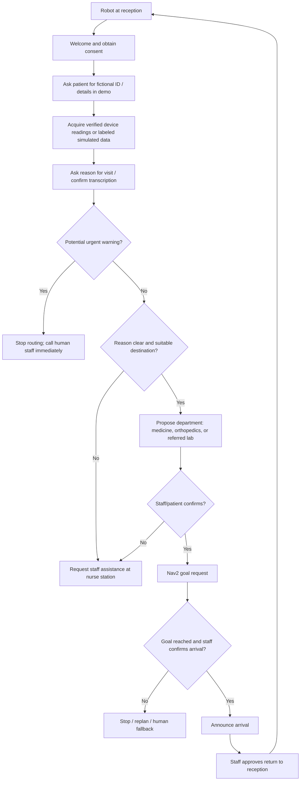

# Proposed technical architecture and interaction state machine

## Sensor and interaction split

**Navigation sensors**: simulated 2D LiDAR -> `/scan`, wheel odometry -> `/odom`, TF -> `/tf`. Optional IMU and depth camera in later phases.

**Patient-entered fields**: name, patient ID, age, optional contact info, requested visit reason. These are supplied voluntarily by voice / touch / QR; **robot navigation sensors cannot measure these facts**.

**Medical measurement interfaces (future)**: a compatible pulse-oximeter, automated BP monitor, thermometer. Use device API/Bluetooth/USB with per-reading status; avoid claiming clinical accuracy without validation. `Vital signs` in the starter CLI are **simulated examples**.

## ROS 2 node architecture (target, not all implemented)

```text
          Gazebo Jetty Hospital World
               |   |    |
          scan odom  cmd_vel
               |   |    ^
           ros_gz_bridge
               |   |    |
               v   v    |
       slam_toolbox -> /map   [planned SLAM]
                    |
       Nav2 planner / controller -> /cmd_vel [planned navigation]
                    ^
                    |
       Navigation Escort Controller [starter: app/nav2_escort.py]
                    ^
                    |
   Patient Workflow Manager [starter: app/patient_demo.py]
      /       |         |          \
  kiosk    reason    vital signs   staff safety override
 [planned] [demo]  [demo values]    [planned]
```

## Workflow state diagram



## Acceptance tests for integration

- Use *fictional* identity and vitals until actual devices and a secure backend are ready.
- Publish only necessary information to authorized staff and log system events, not identifiable patient contents.
- Demonstrate no automatic diagnosis: choose department only under explicit rule and human/patient confirmation.
- Add a nurse-overridden emergency stop (physical emergency stop is mandatory for an actual mobile platform).
- Include localization failure and LiDAR data-loss tests: the robot must stop or enter a safe state.
- Escort requires observing that the patient is actually following or making clear this is **wayfinding**, not continuous patient-following. That capability is not in this starter.
